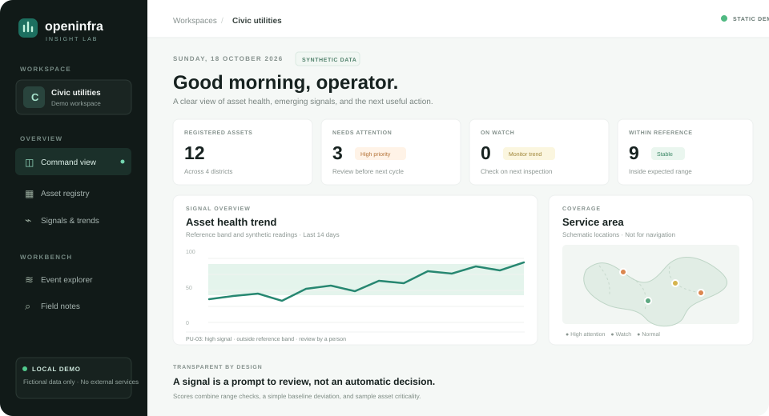

# OpenInfra Insight

### Asset signals that a person can actually explain.

OpenInfra Insight is a local-first analytics workbench for synthetic civic-infrastructure telemetry. It brings together a searchable asset registry, transparent signal scoring, a small trend view, event-log filtering, and a field-note search in one responsive dashboard.

> **Portfolio prototype.** Every asset, location, measurement, and event in this repository is fictional and generated for demonstration. This is not an official government product, is not affiliated with any public agency, and is not intended for operational or safety decisions.



## Run locally

The dashboard has a static browser demo using only local sample data. Open `index.html` directly or publish it with GitHub Pages; it requires no account, build step, or third-party request. For the optional local JSON API, use Python 3.10 or later. The API server uses only Python's standard library.

```powershell
python app.py
```

Open [http://127.0.0.1:8000](http://127.0.0.1:8000) for the API-backed mode. Stop the server with `Ctrl+C`. The server binds to loopback only, so the API is available only on the same computer. When the API is not present, the dashboard automatically uses the bundled synthetic sample.

## What works

- **Asset registry:** search and filter fictional assets by name, ID, type, region, and signal level. Open a record for its reference band, service date, sample criticality, and a human-readable explanation.
- **Trend view:** inspect a repeatable 14-day sample series with a reference band, and switch between assets.
- **Attention scoring:** compare the latest reading with a supplied healthy range and a 13-day baseline. The score is a transparent heuristic; it is not a trained predictive-maintenance model.
- **Schematic coverage view:** place fictional coordinates on a four-district diagram. It is explicitly not a geographic map or navigation aid.
- **Event explorer:** filter sample structured log events by asset, level, or phrase.
- **Field-note search:** find relevant sections in the local markdown playbook with a small term-frequency ranking, without sending text to an AI provider.
- **JSON export:** download the current sample asset snapshot from the browser.
- **API:** read health, summary, assets, asset time series, playbook search, and sample events over local HTTP.

See [Architecture](docs/architecture.md), [Data dictionary](docs/data-dictionary.md), [Method note](docs/method.md), and [Portfolio alignment](docs/portfolio-alignment.md) for details.

## Architecture at a glance

```text
Browser UI (HTML, CSS, JavaScript)
      │ same-origin JSON requests
      ▼
Python standard-library HTTP server
      ├── validated CSV sample records
      ├── deterministic synthetic time series
      ├── transparent range + baseline rules
      ├── local log filtering
      └── local markdown term search
```

The CSV and markdown files are the complete data store. There is no authentication or multi-user mode. Do not expose this prototype to a public network or enter real, personal, sensitive, or operational data.

## Limitations and next steps

The time series and log file are seeded examples, not sensor exports. The scoring rules are illustrative, uncalibrated, and cannot establish a fault or predict failure. The map is schematic. The search ranks local note sections by matching terms and is not a language model. There is no persistent API database, user management, scheduled data ingestion, notification system, or deployment configuration.

A responsible next iteration would begin with domain-reviewed public data, an agreed data dictionary, data-quality checks, an evaluation plan, access controls, and user research. Any real deployment would require engineering and safety review before use.

## Project structure

- `app.py` — local HTTP API, CSV validation, synthetic series, explainable scoring, note search
- `index.html`, `styles.css`, `app.js` — responsive dashboard and browser interactions
- `data/assets.csv` — fictional asset records and reference bands
- `data/sample-events.log` — fictional structured events
- `docs/` — architecture, data definitions, methods, and a local playbook

## License

MIT. See [LICENSE](LICENSE).

The dashboard has a static browser demo using only local sample data. Open `index.html` directly or publish it with GitHub Pages; it requires no account, build step, or third-party request. For the optional local JSON API, use Python 3.10 or later. The API server uses only Python's standard library.

```powershell
python app.py
```

Open [http://127.0.0.1:8000](http://127.0.0.1:8000) for the API-backed mode. Stop the server with `Ctrl+C`. The server binds to loopback only, so the API is available only on the same computer. When the API is not present, the dashboard automatically uses the bundled synthetic sample. To publish the browser demo, configure GitHub Pages to deploy the repository's `main` branch from the root directory.
